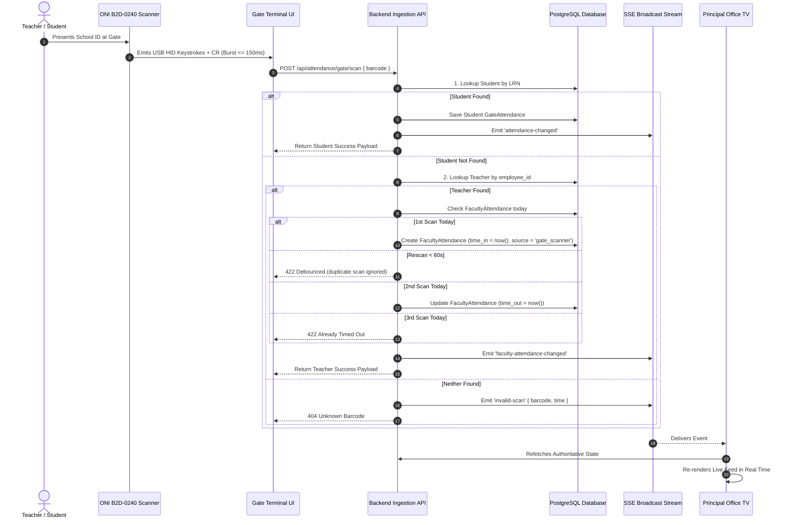

# DIGISKWELA — PHASE 5D PRINCIPAL COMPLETION
## FACULTY ATTENDANCE REQUIREMENT CORRECTION AUDIT
### PHYSICAL TEACHER ID SCANNING & PRINCIPAL TV LIVE MONITORING

**Authoritative Project Identity:** DigiSkwela  
**Authoritative Institution:** Calulut Integrated School  
**Date:** October 14, 2026  
**Document Status:** REQUIREMENTS AUDIT & SYSTEM ARCHITECTURE ONLY  
**Current Verified Progress:** 26 / 29 (89.66%)  
**PRIN-003 Status:** IMPLEMENTED / VALIDATED / REQUIREMENT CORRECTION PENDING  
**PRIN-014 Status:** IMPLEMENTED / VALIDATED / REQUIREMENT CORRECTION PENDING  

---

### Executive Summary

The user has clarified the authoritative final product requirement for Faculty Attendance:
1. **Physical Gate Scanning:** Teachers arrive at Calulut Integrated School and scan their physical school ID barcode/QR using the existing **ONI B2D-0240** USB scanner at the gate terminal.
2. **Automatic Punch Logic:** First valid scan = **Faculty Time In**; second valid scan = **Faculty Time Out**. Teachers do **not** manually open a portal or click buttons to record attendance.
3. **Principal Office TV Live Monitoring:** The Principal monitoring experience must be extended so the office TV can display a real-time chronological feed of Teacher attendance scans alongside the existing Student Gate feed.
4. **Preservation of Proven Systems:** The existing Student Gate Attendance system (`GateAttendance`, `/api/attendance/gate/scan`, `useGateAttendanceSSE`, `GateTerminalScreen`) is proven, validated, and must remain completely intact without data mixing or table merging.

This audit evaluates the architectural gap between the recently completed portal punch workflow and the required physical gate scanner + Principal TV monitoring workflow, identifying all necessary changes, hardware constraints, identity resolution rules, and an exact implementation roadmap.

---

### 1. Corrected Faculty Attendance Requirement

| Dimension | Previous Assumption (Phase 7A/7C) | Authoritative Corrected Requirement |
|---|---|---|
| **Capture Medium** | Teacher Portal web UI button click (`Time In` / `Time Out`) | **Physical school ID scan at gate terminal** using ONI B2D-0240 scanner |
| **User Action** | Teacher logs in on phone/browser and punches | **Teacher presents physical card to optical scanner at gate** |
| **First Scan Semantics** | N/A (Clicked `Time In`) | **Faculty Time In** (recorded automatically to `FacultyAttendance`) |
| **Second Scan Semantics** | N/A (Clicked `Time Out`) | **Faculty Time Out** (recorded automatically to `FacultyAttendance`) |
| **Subsequent Scans** | Handled by button disable states | **Debounced / Rejected cleanly** by server-side scan ingestion |
| **Principal Real-Time Oversight** | Dashboard summary poll + table refresh | **Live SSE TV Feed** streaming chronological Teacher arrivals & departures |
| **Teacher Portal Card** | Interactive punch card with action buttons | **Read-Only "Today's Gate Attendance"** reference card |

---

### 2. Existing Student Gate Architecture Audit

#### 2.1 Hardware Scanner Interface
- **Physical Device:** ONI B2D-0240 USB Barcode / QR Scanner operating in USB HID Keyboard Wedge mode.
- **Output Characteristics:** Decodes barcode and emits characters as rapid keystrokes followed by a carriage return (`Enter` / CR).
- **Burst Duration:** Physically measured and validated at **~116ms for 12 characters** on October 5, 2026.
- **Hook Classifier (`src/app/shared/hooks/useHardwareScanner.ts`):**
  - Uses timing threshold: `SCANNER_BURST_THRESHOLD_MS = 150ms`.
  - Max inter-character gap: `50ms` (distinguishes scanner bursts from human keyboard input).
  - Hardcoded Identifier Constraints:
    ```typescript
    export const DEFAULT_IDENTIFIER_CONFIG: ScannerIdentifierConfig = {
      pattern: /^\d{12}$/, // LRN format: exactly 12 numeric digits
      length: 12,
    };
    ```
  - Submits directly to `POST /api/attendance/gate/scan` with `{ barcode: candidate }`.

#### 2.2 Gate Terminal Screen (`src/app/gate/GateTerminalScreen.tsx` & `GateTerminalApp.tsx`)
- Displays live multi-column list of recent scans (last 32 entries).
- Features dual profile card panels (left/right) with large, high-visibility `IN` / `OUT` stamps, profile photo, student name, and section.
- Plays idle campus media if no scans occur for 60 seconds (`GATE_IDLE_MEDIA_DELAY_MS`).
- Error and invalid scan overlays with automatic reset timer (3,000ms).

#### 2.3 Backend Scan Route (`backend/src/attendance/attendance.routes.ts`)
- **Route:** `POST /api/attendance/gate/scan`.
- **Authorization:** `requireAnyPermission('attendance:write', 'attendance:write_all')` (held by `GateOperator`).
- **Resolver:** `resolveScannedStudent(barcode)` queries `prisma.student.findUnique({ where: { lrn: barcode } })`.
- **First Scan Today:** Creates `gate_attendance` record with `time_in = now()`, `status = 'Present'`. Emits `event: attendance-changed`.
- **Rescan < 60 seconds:** Rejected with 422: `UNPROCESSABLE_ENTITY: Scan ignored (duplicate scan within 1 minute)`.
- **Second Scan >= 60 seconds:** Updates `gate_attendance` record with `time_out = now()`. Emits `event: attendance-changed`.
- **Third Scan:** Rejected with 422: `Student already timed out today`.
- **Unrecognized Barcode:** Calls `emitInvalidScan(barcode)`, logs error, and returns 404 `Student not found`.

---

### 3. Existing Principal TV Monitoring Architecture Audit

#### 3.1 Principal Monitoring Screen (`src/app/principal/monitoring/PMonitoring.tsx`)
- Screen identifier: `p-monitoring` in `PrincipalApp.tsx`.
- Upper KPI strip: `Inside Campus`, `Already Left`, `Late Today`.
- Middle Analytics: Attendance Analytics chart (Daily, Weekly, Monthly, By Grade, By Section).
- Lower Section (2-Column Grid):
  - **Left Column:** "Live QR Gate Feed" table displaying live scans, connection status pill (`LIVE UPDATES` vs `RECONNECTING...`), and chronological entries with `In` (emerald), `Out` (blue), or `Invalid` (red) stamps.
  - **Right Column:** "Late Arrivals" table and "Parent Notification Log".
- **Legacy Finding:** Lines 194–209 of `PMonitoring.tsx` contain **two hardcoded static mock rows** for `Santos, Maria (Teacher)` and `Dela Cruz, Anna (Teacher)`. These mock rows confirm the original intent to display teacher gate activity, but were hardcoded placeholders rather than live database-driven records.

#### 3.2 Real-Time SSE Stream (`src/app/shared/hooks/useGateAttendanceSSE.ts`)
- Connects to `GET /api/attendance/gate/events`.
- Invalidation-only pattern: On `attendance-changed`, calls `refreshGateAttendance()`, which fetches fresh PostgreSQL records from `GET /api/attendance/gate`.
- On `invalid-scan`, appends to `invalidScans` state in `AppContext`.
- Native browser `EventSource` with automated reconnect, cookie authentication, and 25s server heartbeats.

---

### 4. FacultyAttendance Data Compatibility

The recently implemented `FacultyAttendance` model in PostgreSQL is **100% compatible** with physical gate scanning:

```prisma
model FacultyAttendance {
  id               String    @id @db.VarChar(36)
  teacher_id       String    @db.VarChar(36)
  date             DateTime  @db.Date
  time_in          DateTime? @db.Timestamptz(3)
  time_out         DateTime? @db.Timestamptz(3)
  capture_source   String    @default("web_teacher") @db.VarChar(30)
  override_status  String?   @db.VarChar(30)
  override_remarks String?   @db.VarChar(255)
  corrected_by_id  String?   @db.VarChar(36)
  created_at       DateTime  @default(now())
  updated_at       DateTime  @updatedAt
  ...
}
```

- **Capture Source:** Accepts `capture_source = 'gate_scanner'`.
- **Database Unique Constraint:** `@@unique([teacher_id, date])` naturally enforces one daily record per teacher.
- **Timestamps:** Stores exact UTC instants (`Timestamptz(3)`), formatted in `Asia/Manila` on read.
- **No Schema Changes Needed:** Stored facts (`date`, `time_in`, `time_out`, `capture_source`) perfectly model physical gate check-in and check-out.

---

### 5. Teacher Physical-ID Evidence

> [!WARNING]
> **CLASSIFICATION: FACULTY PHYSICAL ID FORMAT — NOT VERIFIED**

A complete repository audit reveals:
1. **Database Schema:** `Teacher.employee_id` exists as `VARCHAR(50) @unique`.
2. **Seed Data:** `backend/seed_demo_accounts.ts` sets `employee_id = 'EMP-T-001'` for demo teacher `Maria Clara`.
3. **Card Generator / Templates:** **Zero** ID card generation code, templates, or barcode format specifications exist in the codebase for teachers.
4. **Physical Reality:** We have **no proof** whether the physical Calulut Integrated School Teacher ID card:
   - Encodes DepEd Employee ID (typically a 7-digit numeric string in DepEd national payroll).
   - Encodes a school-specific alphanumeric code (e.g., `EMP-T-001`, `CIS-FAC-001`, `T-100234`).
   - Encodes a QR code containing text or structured data.
   - Has a prefix, suffix, or special character framing.

**Action Required:** Physical verification is mandatory before hardcoding any parser or pattern (see Section 17).

---

### 6. Scanner Classifier Constraints

The current classifier in `src/app/shared/hooks/useHardwareScanner.ts` strictly enforces:
```typescript
if (bufferRef.current.length === config.length) { ... }
if (duration <= SCANNER_BURST_THRESHOLD_MS && config.pattern.test(candidate)) { ... }
```
Where `config.length = 12` and `config.pattern = /^\d{12}$/`.

#### Implications:
1. If an actual Teacher ID has **9 characters** (like `'EMP-T-001'`), it will be **silently dropped** at line 159:
   `Dropped scan. Buffer length was 9, expected 12`.
2. If an actual Teacher ID contains **hyphens or letters**, it will fail `/^\d{12}$/`.
3. **Critical Rule:** We must **preserve the hardware speed threshold** (`duration <= 150ms`, inter-key gap < 50ms) because this is what physically separates scanner bursts from human typing.
4. **Required Evolution:** The hook's length check must be loosened to a length range (e.g. `min: 4, max: 50`) or dual pattern matcher (`studentPattern | teacherPattern`) once the physical Teacher ID format is verified.

---

### 7. Unified vs. Separate Identity Resolution

| Option | Architecture | Evaluation |
|---|---|---|
| **Option A: Unified Scanner Ingestion** *(Recommended)* | The gate scanner sends any valid burst to a single ingestion endpoint (`POST /api/attendance/gate/scan`). The backend resolves whether the barcode belongs to a Student or a Teacher. | **Superior UX.** Gate operator does not have to switch modes or select "Student" vs "Teacher". Natural hardware workflow. |
| **Option B: Separate Gate Terminals / Endpoints** | Two separate terminal screens or a toggle switch on the gate terminal. | **High friction.** Gate operator would constantly need to click toggle buttons when teachers and students arrive mixed in line. |

---

### 8. Collision Analysis

Could a Student LRN collide with a Teacher Employee ID?
- **DepEd Student LRN:** Strictly **12 numeric digits**, governed by DepEd national LIS.
- **DepEd Teacher Employee ID:** Typically **7 numeric digits** or alphanumeric with prefix/hyphens.
- **Collision Risk:** **Negligible to Zero** under standard DepEd numbering conventions.
- **Deterministic Resolution Strategy:**
  1. Check `Student` table by `lrn`. If match found $\rightarrow$ execute Student Gate Attendance.
  2. If not found, check `Teacher` table by `employee_id`. If match found $\rightarrow$ execute Faculty Attendance.
  3. If found in neither $\rightarrow$ trigger `invalid-scan` event and return 404.
  4. If both exist (hypothetical collision) $\rightarrow$ log an authoritative system warning and prioritize Student (or evaluate configured identifier rules).

---

### 9. Faculty Scan Ingestion Design



---

### 10. GateOperator Authorization & Least Privilege

- **Current Permission:** `GateOperator` has `attendance:write`.
- **Security Constraint:** `GateOperator` must **NOT** be granted `faculty_attendance:write`.
  - `faculty_attendance:write` is the high-privilege administrative permission used by Admin/ITAdmin to correct timestamps and assign Official Business overrides.
- **Implementation:** The gate terminal calls `POST /api/attendance/gate/scan`, authorized by `attendance:write`. The backend endpoint safely routes teacher scans to the internal `facultyAttendance.service` using trusted system context. GateOperator cannot forge timestamps, modify past dates, or assign administrative overrides.

---

### 11. Real-Time Update Architecture: Faculty SSE Design

#### Comparison of Options:
- **Option A (Multiplexed Gate Events):**
  - Use existing `GET /api/attendance/gate/events`.
  - Emits:
    - `event: attendance-changed` (Student gate scan)
    - `event: faculty-attendance-changed` (Teacher gate scan)
    - `event: invalid-scan` (Unrecognized barcode)
  - **Advantage:** Single EventSource connection per TV client. Avoids HTTP/1.1 connection exhaustion limits (browsers limit to 6 persistent SSE streams per origin).
- **Option B (Separate SSE Stream):**
  - Add `GET /api/attendance/faculty/events` under `facultyAttendance.routes.ts`.
  - **Advantage:** Isolated authorization (`faculty_attendance:read`).
  - **Disadvantage:** Two separate persistent HTTP connections per monitoring TV.
- **Recommendation:** **Option A (Multiplexed)** or **Consolidated Live Stream** is optimal for the Principal TV, as the TV monitors both streams simultaneously on one screen.

---

### 12. Principal Faculty Live Feed UI Design

#### Layout Concept in Principal Monitoring (`PMonitoring.tsx`):
Replace the hardcoded mock rows with an interactive dual-tab or split-feed monitoring experience:

```
┌────────────────────────────────────────────────────────────────────────┐
│  PRINCIPAL LIVE MONITORING — CALULUT INTEGRATED SCHOOL TV FEED        │
│  [ ● LIVE UPDATES ]                                                   │
├────────────────────────────────────────────────────────────────────────┤
│  Tabs: [ Student Gate Feed (Live) ]  [ Faculty Attendance Feed (Live) ]│
├────────────────────────────────────────────────────────────────────────┤
│  Chronological Scan Events (Newest First):                             │
│  ┌──────────────────────────────────────────────────────────────────┐  │
│  │ 08:02 AM  Santos, Maria (Teacher)      MATHEMATICS   [ TIME IN ] │  │
│  │ 07:58 AM  Dela Cruz, Juan (Student)    10 - RIZAL    [   IN    ] │  │
│  │ 07:55 AM  Reyes, Roberto (Teacher)     SCIENCE       [ TIME IN ] │  │
│  │ 07:51 AM  Bautista, Ana (Teacher)      ENGLISH       [ TIME IN ] │  │
│  │ 07:44 AM  Invalid Scan [99998888]      UNKNOWN       [ INVALID ] │  │
│  └──────────────────────────────────────────────────────────────────┘  │
└────────────────────────────────────────────────────────────────────────┘
```

#### Shared Visual Language:
- **Large Screen / TV Legibility:** High-contrast text, clear uppercase name headings.
- **Event Stamps:**
  - `TIME IN` / `IN`: Emerald badge (`bg-emerald-100 text-emerald-800 border-emerald-300`)
  - `TIME OUT` / `OUT`: Blue badge (`bg-blue-100 text-blue-800 border-blue-300`)
  - `INVALID`: Red badge (`bg-rose-100 text-rose-800 border-rose-300`)
- **Metadata:** Department & Position for faculty (e.g., `Mathematics · Teacher I`); Grade & Section for students (e.g., `Grade 10 · Rizal`).

---

### 13. PRIN-003 Relationship

- **PRIN-003** (Principal Dashboard KPI Card: "Faculty Checked In Today"):
  - Primary Metric: `<checkedInCount> / <totalActiveFaculty> Checked In`
  - Subtitle: `<onLeaveCount> On Leave · <pendingCheckInCount> Pending Check-In`
  - Live data source: `GET /api/attendance/faculty/summary` (based on real `FacultyAttendance` records created by gate scans).
  - **Navigation Recommendation:** Clicks through to `p-teachers` (detailed roster table), with a prominent "Open TV Monitoring" button linking directly to `p-monitoring`.

---

### 14. PRIN-014 Relationship

- **PRIN-014** (Faculty Attendance Table in `PTeachers.tsx`):
  - **Role:** Comprehensive daily operational & historical attendance table.
  - Features: Date selector, search by name/employee ID, status filter (`Completed`, `Time Out Pending`, `On Leave`, `Official Business`, `Not Checked In`), pagination.
  - **Distinction from TV Feed:**
    - **PRIN-014:** Full active faculty roster (shows who is here, who is on leave, and who hasn't checked in yet).
    - **Faculty Live Feed (TV):** Chronological stream of scan actions as they happen in real time.

---

### 15. TeacherPunchCard Disposition

#### Audit Finding:
The interactive `TeacherPunchCard.tsx` currently contains active `Time In` and `Time Out` action buttons that invoke `POST /api/attendance/faculty/time-in` and `time-out`. This violates the physical-scan-only requirement.

#### Action:
**Repurpose as Read-Only "Today's Gate Attendance" Card:**
1. Remove all manual action buttons (`Time In` / `Time Out`).
2. Keep display slots showing:
   - Arrival Time (`Time In` instant or `—`)
   - Departure Time (`Time Out` instant or `—`)
   - Status badge pill (`Not Checked In`, `Time Out Pending`, `Completed`, `On Leave`, `Official Business`)
3. Add explanatory guidance text:
   *"Attendance is recorded automatically when you scan your physical school ID at the gate terminal."*

---

### 16. Invalid Scan Behavior

1. **Gate Terminal Display:** Shows large warning card with sound/visual cue: `Scan Failed: Unrecognized ID`.
2. **Principal TV Feed:** Emits `invalid-scan` event with raw barcode and timestamp; renders as `Invalid Scan: [Barcode]` without creating fraudulent attendance rows.
3. **Database Integrity:** Zero rows inserted into `faculty_attendance` or `gate_attendance` for unknown identifiers.

---

### 17. Physical Verification Required from User

Before modifying hardware scanner classifiers or parser regexes in production code, the user must perform this simple physical test:

> [!IMPORTANT]
> **PHYSICAL TEST INSTRUCTION FOR USER:**
> 1. Open **Notepad** (or any text editor) on the computer connected to the ONI B2D-0240 scanner.
> 2. Scan an actual **Teacher ID** card with the scanner.
> 3. Copy and paste the exact character string that appears into this chat.
> 4. Tell us:
>    - Exactly what characters appeared.
>    - Does it match the teacher's DepEd Employee ID number?
>    - Does it contain letters, hyphens, or only numbers?
>    - Does it press Enter automatically?

---

### 18. Exact Corrective Implementation Plan

Once the physical scan format is verified by the user:

1. **Phase 1: Scanner Ingestion & Unified Dispatcher**
   - Update `useHardwareScanner.ts` to accommodate the verified Teacher ID length/pattern alongside 12-digit student LRNs.
   - Update `POST /api/attendance/gate/scan` to resolve Student first, then Teacher, recording to `FacultyAttendance` with `capture_source = 'gate_scanner'`.
   - Update `GateTerminalScreen.tsx` to format Teacher scan success cards (Teacher name, Department, `TIME IN` / `TIME OUT`).

2. **Phase 2: SSE Real-Time Event Multiplexing**
   - Update `attendance.routes.ts` to emit `event: faculty-attendance-changed`.
   - Update `useGateAttendanceSSE.ts` to dispatch faculty updates to the Principal store.

3. **Phase 3: Principal Live Monitoring Feed (TV)**
   - Remove hardcoded mock teacher rows in `PMonitoring.tsx`.
   - Add segmented control / tabs in `PMonitoring.tsx`: `[ Student Gate Feed ]` and `[ Faculty Attendance Feed ]`.
   - Wire Faculty feed to live chronological events derived from `FacultyAttendance`.

4. **Phase 4: Repurpose Teacher Portal Punch Card**
   - Transform `TeacherPunchCard.tsx` into a read-only "Today's Gate Attendance" card.
   - Remove manual `recordTimeIn` / `recordTimeOut` action buttons.

5. **Phase 5: Automated Regression Testing & Verification**
   - Add integration tests for gate teacher scan ingestion, debouncing, Time Out updates, invalid scan emissions, and Principal TV feed synchronization.

---

### 19. Authoritative Progress Accounting

```
Current Principal Verified Progress: 26 / 29 (89.66%)
PRIN-003:                           IMPLEMENTED / VALIDATED / REQUIREMENT CORRECTION PENDING
PRIN-014:                           IMPLEMENTED / VALIDATED / REQUIREMENT CORRECTION PENDING
PRIN-004:                           STRICTLY OUT OF SCOPE
```

*(No production code has been modified during this audit phase. The system is stopped and awaiting user physical test verification.)*
