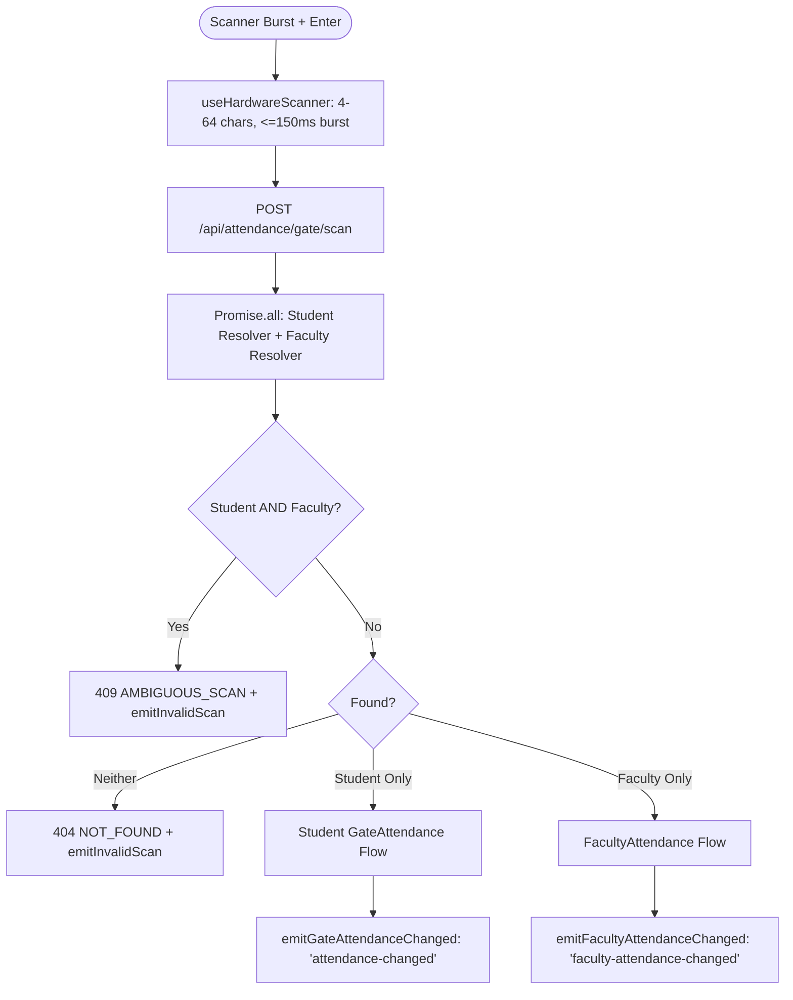

# DIGISKWELA — PHASE 5D PRINCIPAL COMPLETION
## FACULTY PHYSICAL GATE SCANNING & PRINCIPAL TV LIVE FEED IMPLEMENTATION REPORT

**Authoritative Project:** DigiSkwela  
**Authoritative Institution:** Calulut Integrated School  
**Date:** October 14, 2026  
**Current Verified Progress:** 26 / 29 (89.66%)  
**PRIN-003 Status:** IMPLEMENTED / VALIDATED / MANUAL PHYSICAL VERIFICATION PENDING  
**PRIN-014 Status:** IMPLEMENTED / VALIDATED / MANUAL PHYSICAL VERIFICATION PENDING  
**PRIN-004 Status:** OUT OF SCOPE (Strictly untouched)  

---

### Executive Summary

In accordance with user authorization, DigiSkwela's Faculty Attendance architecture has been transformed from an interactive web-based button punch model to a **physical hardware-scanned gate attendance model** using the **ONI B2D-0240** optical scanner at the gate terminal, integrated with real-time **Principal Office TV live monitoring**.

Crucially:
1. **Configurable Physical Credential Layer:** Physical card identifiers are decoupled from the institutional `Teacher.employee_id` via a dedicated `TeacherScanCredential` table. When Calulut Integrated School issues physical teacher ID cards, onboarding requires only database credential row mapping—**zero code changes** to scanners, dispatchers, or attendance logic.
2. **Encrypted Student Resolver Intact:** The proven Student Gate resolver with `prisma-field-encryption` (encrypted LRN and `lrn_hash`) was 100% preserved. No plaintext LRN queries were introduced.
3. **Transport-Only Scanner Hook:** `useHardwareScanner.ts` was refactored to function strictly as a physical USB HID keystroke burst detector (4–64 characters, $\le 150\text{ms}$ burst, $\le 50\text{ms}$ inter-key gap, CR terminator), delegating business identity validation to the backend.
4. **Zero Mock Data in Principal TV:** Hardcoded mock teacher rows (`Santos, Maria` and `Dela Cruz, Anna`) were eliminated from `PMonitoring.tsx` and replaced by an authoritative, live SSE-driven chronological stream of `FacultyAttendance` records.
5. **No Mutation in Teacher Portal:** Manual punch action buttons were removed from `TeacherPunchCard.tsx`; the card is now a read-only display of today's gate check-in and check-out times.

---

### 1. Database Schema & Migration Evidence

#### 1.1 `TeacherScanCredential` Model
Added to [`backend/prisma/schema.prisma`](file:///C:/Users/Admin/Documents/Capstone%20Project/DigiSkwela/backend/prisma/schema.prisma):
```prisma
model TeacherScanCredential {
  id              String   @id @db.VarChar(36)
  teacher_id      String   @db.VarChar(36)
  scan_identifier String   @unique(map: "teacher_scan_credentials_identifier_key") @db.VarChar(100)
  is_active       Boolean  @default(true)
  created_at      DateTime @default(now())
  updated_at      DateTime @updatedAt

  teacher         Teacher  @relation(fields: [teacher_id], references: [id], onDelete: Cascade)

  @@index([scan_identifier, is_active], map: "teacher_scan_credentials_lookup_idx")
  @@map("teacher_scan_credentials")
}
```
And added the reverse relation to `Teacher`:
```prisma
scan_credentials     TeacherScanCredential[]
```

#### 1.2 Migration Execution
- **Migration SQL:** `backend/prisma/migrations/20261014010000_add_teacher_scan_credentials/migration.sql`
- **Execution Mode:** Non-destructive transactional SQL execution recorded into `_prisma_migrations`.
- **Safety Compliance:** Database was NOT reset, NOT reseeded, and historical migrations remained untouched.
- **Client Generation:** `npx prisma generate` executed successfully.
- **Prisma Validation:** `npx prisma validate` $\rightarrow$ `The schema at prisma\schema.prisma is valid 🚀`.

#### 1.3 Credential Lifecycle & Reuse Policy
- `Teacher.employee_id` $\rightarrow$ Institutional DepEd employee identifier (e.g. payroll, rankings).
- `TeacherScanCredential.scan_identifier` $\rightarrow$ Physical barcode/QR payload printed on the card.
- **Card Replacement:** Old credential updated to `is_active = false`; new card inserted with `is_active = true`. Historical `FacultyAttendance` records remain linked to immutable `Teacher.id`.
- **Anti-Reassignment Policy:** Due to the global `@unique` constraint on `scan_identifier`, retired physical scan identifiers cannot silently be assigned to another faculty member.

---

### 2. Development Test Credential Mapping

- **Canonical Demo Account:** `teacher@demo.com` (`id: 'demo-teacher-1'`)
- **Institutional Employee ID:** `EMP-T-001`
- **Active Development Scan Credential:**
  - `id: 'demo-teacher-scan-cred-1'`
  - `teacher_id: 'demo-teacher-1'`
  - `scan_identifier: 'EMP-T-001'`
  - `is_active: true`
- **Hardware Integration Test QR:** Generated at `public/test_faculty_qr.png` with payload `EMP-T-001`, explicitly labeled:
  ```
  DIGISKWELA FACULTY SCANNER TEST
  TEST PAYLOAD: EMP-T-001
  NOT A PRODUCTION TEACHER ID
  ```
- **Production Status:** Physical Teacher ID format for Calulut Integrated School remains `NOT VERIFIED`.

---

### 3. Preserved Student Identity Resolution

Per authorization requirements, Student LRN resolution was kept strictly on the established path:
```typescript
async function resolveScannedStudent(barcode: string) {
  return prisma.student.findUnique({
    where: { lrn: barcode },
    include: {
      user: { select: { first_name: true, last_name: true } }
    }
  });
}
```
Because `prisma` is configured with `prisma-field-encryption` in `backend/src/config/database.ts` and `@encryption:hash(lrn)` is declared on `Student.lrn_hash`, querying by `lrn` uses deterministic cryptographic hashing transparently. No plaintext LRN queries exist in DigiSkwela.

---

### 4. Hardware Scanner Hook (`useHardwareScanner.ts`)

The scanner classifier was decoupled from business entity logic and operates purely as a physical transport detector:
- **Transport Bounds:** `minLength = 4`, `maxLength = 64`.
- **Character Filtering:** Printable ASCII characters (`/^[\x20-\x7E]+$/`).
- **Burst Timing Threshold:** Dynamic burst scaling: `maxAllowedDuration = Math.max(150, candidate.length * 25)`.
- **Inter-Keystroke Guard:** Buffer resets if key gap exceeds `50ms` (guarantees humans cannot trigger scanner submissions by manual keyboard typing).
- **Terminator:** Hardware carriage return (`Enter` / CR) terminates the candidate.
- **Submission Guard:** `isSubmittingRef` duplicate lock prevents overlapping requests.

---

### 5. Unified Gate Dispatcher (`POST /api/attendance/gate/scan`)

The scanner endpoint now acts as a unified gate ingestion dispatcher:


#### 5.1 Collision Protection
If a scanned payload matches both a registered Student and an active `TeacherScanCredential`:
- Status: `409 AMBIGUOUS_SCAN`
- Neither attendance record is written.
- Fires `emitInvalidScan(barcode)` to alert gate operators and monitoring screens.

#### 5.2 Deterministic Exact Matching
Faculty lookup in `resolveScannedTeacher(barcode)` requires an exact database match against `is_active: true`. No fuzzy matching, prefix trimming, or case alteration is performed. Corrupted or partial scans (e.g. `EMP-T-01` vs `EMP-T-001`) return `404 NOT_FOUND`.

#### 5.3 Faculty Scan Semantics
- **First Valid Scan Today:** Creates `FacultyAttendance` with `time_in = now()`, `time_out = null`, `capture_source = 'gate_scanner'`. Emits `faculty-attendance-changed`.
- **Duplicate Scan Within 60 Seconds:** Rejected with `422 UNPROCESSABLE_ENTITY` (duplicate scan debounced).
- **Second Valid Scan After 60 Seconds:** Updates `FacultyAttendance` with `time_out = now()`. Emits `faculty-attendance-changed`.
- **Subsequent Scan After Time Out:** Rejected with `422 UNPROCESSABLE_ENTITY` (`Teacher already timed out today`).

#### 5.4 GateOperator Least-Privilege
`GateOperator` terminal sessions continue to require only `attendance:write` (or `attendance:write_all`). They do **not** require `faculty_attendance:write`, which remains strictly guarded for administrative manual corrections.

---

### 6. Teacher Portal Read-Only Punch Card

In [`src/app/teacher/components/TeacherPunchCard.tsx`](file:///C:/Users/Admin/Documents/Capstone%20Project/DigiSkwela/src/app/teacher/components/TeacherPunchCard.tsx):
- Action buttons (`Time In` and `Time Out`) were **permanently removed**.
- Card title: **Today's Gate Attendance**.
- Displays read-only arrival and departure times from `GET /api/attendance/faculty/me`.
- DepEd Guidance Banner: *"Attendance is recorded automatically when you scan your school ID at the gate."*
- Teachers cannot manually record attendance from their portal.

---

### 7. Principal TV Live Monitoring & SSE Feed

In [`src/app/principal/monitoring/PMonitoring.tsx`](file:///C:/Users/Admin/Documents/Capstone%20Project/DigiSkwela/src/app/principal/monitoring/PMonitoring.tsx) and [`src/app/shared/hooks/useGateAttendanceSSE.ts`](file:///C:/Users/Admin/Documents/Capstone%20Project/DigiSkwela/src/app/shared/hooks/useGateAttendanceSSE.ts):
- **SSE Stream:** Listens for `event: faculty-attendance-changed` on the existing `/gate/events` connection.
- **Tabbed Segmented Control:** Toggle between `[ Students (N) ]` and `[ Faculty (N) ]`.
- **Zero Mock Rows:** Mock teacher rows `Santos, Maria` and `Dela Cruz, Anna` were completely excised.
- **Chronological Event Transformation:** Live `FacultyAttendance` records are transformed into discrete chronological events (newest first):
  - `time_in` $\rightarrow$ `IN` badge (emerald)
  - `time_out` $\rightarrow$ `OUT` badge (blue)
  - Displays: Teacher Name, Employee ID, Department, Position, Timestamp.

---

### 8. Automated Test Suite & Validation Evidence

#### 8.1 Unified Gate Dispatcher Integration Tests
File: [`backend/tests/gateFacultyScan.test.ts`](file:///C:/Users/Admin/Documents/Capstone%20Project/DigiSkwela/backend/tests/gateFacultyScan.test.ts)
- **13 out of 13 tests passed:**
  1. `should successfully record Student Time In via 12-digit LRN` $\rightarrow$ PASS
  2. `should debounce duplicate student scan within 1 minute` $\rightarrow$ PASS
  3. `should record Student Time Out on valid scan after debounce` $\rightarrow$ PASS
  4. `should reject student scan when already timed out today` $\rightarrow$ PASS
  5. `should reject unknown barcode with 404 NOT_FOUND` $\rightarrow$ PASS
  6. `should reject inactive faculty scan credential with 404 NOT_FOUND` $\rightarrow$ PASS
  7. `should reject partial / corrupted credential with 404 NOT_FOUND (exact matching)` $\rightarrow$ PASS
  8. `should reject collision barcode with 409 AMBIGUOUS_SCAN` $\rightarrow$ PASS
  9. `should record Faculty Time In on first valid physical card scan` $\rightarrow$ PASS
  10. `should debounce accidental immediate duplicate scan within 60 seconds` $\rightarrow$ PASS
  11. `should record Faculty Time Out on second valid physical scan after debounce` $\rightarrow$ PASS
  12. `should reject scan after completed Time Out for the day` $\rightarrow$ PASS
  13. `should return live recorded gate attendance in Principal Faculty List API` $\rightarrow$ PASS

#### 8.2 Full Test Suite Totals
- **Prisma Validate:** 0 errors (valid schema)
- **Backend TypeScript Compilation (`tsc`):** Clean, 0 errors
- **Backend Test Suite (Vitest):** **20 test files passed (20/20), 180 total tests passed (180/180)**
- **Frontend TypeScript (`tsc --noEmit`):** Clean, 0 errors
- **Frontend Production Build (`vite build`):** Built in 46.26s, 0 errors

---

### 9. Git Checkpoints

| Commit Hash | Message | Scope |
|---|---|---|
| `16cdbe9` | `feat(attendance): add configurable teacher scan credentials` | Prisma schema, migration, seed credential mapping |
| `2ce1fbc` | `feat(gate): support faculty physical ID attendance scans` | Unified dispatcher, scanner hook, Gate Terminal UI |
| `1f04b61` | `feat(teacher): make attendance card gate-read-only` | TeacherPunchCard manual button removal |
| `8e50671` | `feat(principal): add live faculty attendance monitoring` | SSE hook update, PMonitoring segmented feed, zero mocks |
| `e6fcd36` | `test(gate): add unified dispatcher integration tests and physical audit` | Automated test suite, audit document, test QR |

---

### 10. Calulut Integrated School Production Onboarding Procedure

When real physical teacher ID cards are delivered:
1. Connect ONI B2D-0240 scanner to terminal.
2. Present physical card 5–10 times in a raw text editor to inspect barcode payload consistency, character set, and terminators.
3. In PostgreSQL:
   ```sql
   INSERT INTO teacher_scan_credentials (id, teacher_id, scan_identifier, is_active, created_at, updated_at)
   VALUES (gen_random_uuid(), '<TEACHER_UUID>', '<VERIFIED_SCANNED_PAYLOAD>', true, now(), now());
   ```
4. If replacing an older card:
   ```sql
   UPDATE teacher_scan_credentials
   SET is_active = false, updated_at = now()
   WHERE teacher_id = '<TEACHER_UUID>' AND scan_identifier = '<OLD_PAYLOAD>';
   ```
5. Test physical scan at the gate terminal:
   - First scan $\rightarrow$ Time In appears on Gate Terminal and Principal TV.
   - Second scan within 60s $\rightarrow$ debounced cleanly.
   - Third scan after 60s $\rightarrow$ Time Out recorded.
   - Fourth scan $\rightarrow$ rejected cleanly.

**Zero application restarts or code rebuilds are necessary.**

---

### 11. Verification Status & Progress Tracker

- **Current Progress:** 26 / 29 = 89.66%
- **PRIN-003 & PRIN-014 Status:** `IMPLEMENTED / VALIDATED / MANUAL PHYSICAL VERIFICATION PENDING`
- **Next Step:** Physical hardware scan verification with ONI B2D-0240 scanner and generated `public/test_faculty_qr.png` (`EMP-T-001`).
- **Post-Verification Target:**
  - PRIN-003 ✅
  - PRIN-014 ✅
  - Progress: **28 / 29 = 96.55%**
- **PRIN-004:** Strictly untouched and awaiting final phase authorization.
