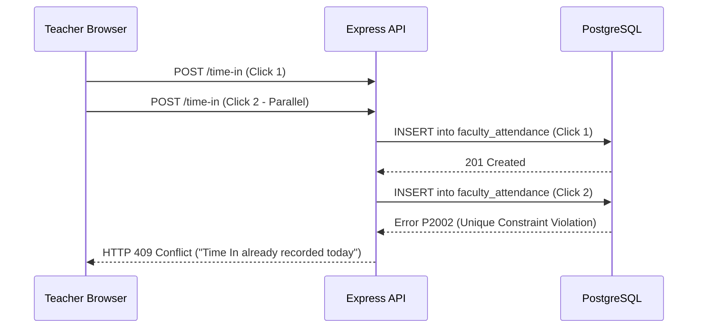
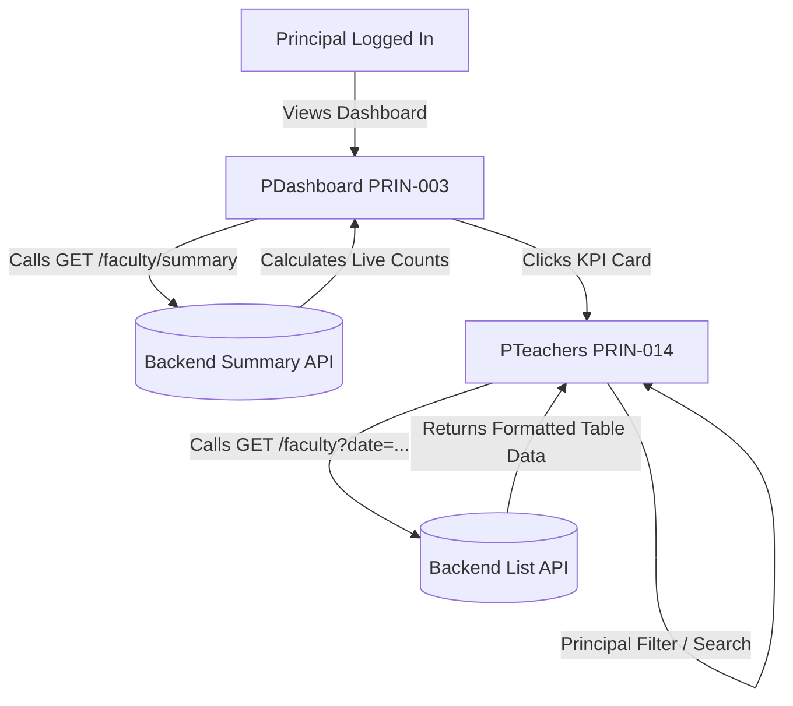

# DIGISKWELA — PHASE 5D PRINCIPAL COMPLETION 7A
## Faculty Attendance: Business Rule Lock & Architecture Design Specification

**Document:** `PHASE_5D_PRINCIPAL_COMPLETION_7A_FACULTY_ATTENDANCE_DESIGN.md`  
**Date:** 2026-10-14  
**Project:** DigiSkwela  
**Institution:** Calulut Integrated School  
**Domain:** Faculty & Teacher Daily Attendance  
**Target Features:** PRIN-003 (Teacher Attendance List) & PRIN-014 (Faculty Attendance Table)  
**Authoritative Principal Progress:** 26 / 29 = 89.66% *(Frozen — Design Only, No Implementation)*  

---

### Executive Overview

Following the accepted Domain Discovery Audit (Classification C: No existing faculty attendance domain), this document establishes the **locked architectural design** and **business rules** for introducing Faculty Attendance into DigiSkwela. 

This design:
1. **Completely separates** faculty attendance from student gate scanning.
2. Implements **authenticated Teacher Portal self-service** for explicit Time In and Time Out.
3. Grants **strict read-only oversight** to the Principal for PRIN-003 and PRIN-014.
4. Reserves **administrative correction** to ITAdmin / Admin with comprehensive audit logging.
5. Provides **atomic concurrency and timezone guarantees** tailored to Calulut Integrated School (Philippine Standard Time, UTC+8).
6. Derives **On Leave** status legitimately from approved `LeaveRequest` records.
7. **Isolates all unsupplied school policy parameters** (work start time, grace period, working days, absence cutoff) so that technical implementation can proceed without fabricating school policy.

---

### 1. Locked Business Rules

| Rule Area | Policy Decision | Justification / Repository Context |
|---|---|---|
| **Capture Method** | **Teacher Portal Web Self-Service (LOCKED)** | Faculty will **NOT** scan at the student gate. Student Gate Attendance (`GateAttendance`, ONI B2D-0240 QR scanner) remains 100% untouched. Faculty check in and check out via authenticated buttons in the Teacher Portal. |
| **Time Out Policy** | **Strictly Explicit (LOCKED)** | Time Out requires an explicit button click. **No auto-checkout, no browser-close checkout, no logout checkout, no end-of-day guessing.** A missing Time Out remains honestly incomplete (`null`). |
| **Identity Protection** | **Server-Derived Identity (LOCKED)** | Teachers **cannot** supply a `teacher_id` in request payloads. The server resolves `teacher_id` exclusively from `req.user.id` via verified JWT session cookies. |
| **Principal Scope** | **Read-Only Oversight (LOCKED)** | Principal receives full read access to summaries, tables, date filters, and status filters. **Principal is granted ZERO mutation or correction rights** in PRIN-003 and PRIN-014. |
| **Admin Scope** | **Authorized Corrections Only** | ITAdmin / Admin can perform manual overrides (e.g. Official Business, correcting missed Time Out) with mandatory audit logging. |
| **Leave Rule** | **LeaveRequest ≠ FacultyAttendance** | Leaves are managed in `leave_requests`. A teacher with an approved leave on a given date is dynamically or explicitly marked `"On Leave"`. |
| **Official Business** | **Exceptional Status Only** | No workflow exists for travel authorities in DigiSkwela. Official Business (OB) is supported as an administrative status override. |
| **Punctuality / Absence** | **Policy-Gated (LOCKED)** | Automatic calculation of `Late` and `Absent` is **NOT locked** until Calulut Integrated School provides official schedule policies. |

---

### 2. Existing-Domain Repository Evidence

The repository was re-audited to confirm all structural dependencies:

1. **`GateAttendance` (`gate_attendance`):**
   - Strictly references `student_id -> Student.id`.
   - Hardware endpoint `POST /api/attendance/gate/scan` resolves barcodes exclusively against `Student.lrn`.
   - **Conclusion:** Overloading this table would break relational integrity and student gate events. The locked decision to keep gate scanning student-only is validated.

2. **`Teacher` Profile (`teachers`):**
   - Verified columns:
     - `id`: `String @id @db.VarChar(36)`
     - `user_id`: `String @unique @db.VarChar(36)` (Foreign key to `users.id`)
     - `employee_id`: `String @unique @db.VarChar(50)` (DepEd Employee ID)
     - `department`: `String? @db.VarChar(100)` (e.g. Mathematics, Science, English, MAPEH)
     - `position`: `String? @db.VarChar(100)` (DepEd Rank: Teacher I, Teacher II, Teacher III, Master Teacher I)
     - `specialization`: `String? @db.VarChar(200)`
     - `date_hired`: `DateTime?`
   - **Conclusion:** `Teacher` legitimately contains `employee_id`, `department`, and `position`. All required fields for PRIN-014 exist.

3. **`TeacherSubjectAssignment` (`teacher_subject_assignments`):**
   - Columns: `academic_year_id`, `teacher_id`, `section_id`, `subject_id`, `days`, `start_time`, `end_time`, `room`.
   - **Finding:** Represents individual section teaching loads (e.g., Section 10-Rizal Math from 08:00 to 09:00).
   - **Conclusion:** **FACULTY WORK SCHEDULE DOMAIN / POLICY NOT AVAILABLE**. This entity does not define full-day employment shifts (e.g. DepEd 8:00 AM – 5:00 PM).

4. **`LeaveRequest` (`leave_requests`):**
   - Columns: `id`, `user_id`, `type`, `start_date`, `end_date`, `days`, `status`, `approver_id`.
   - `Teacher.user_id` maps 1:1 with `User.id`.
   - **Conclusion:** An approved leave (`status = 'Approved'`) spanning a queried date can be reliably queried to derive `"On Leave"` status.

5. **Official Business / Duty Domain:**
   - Grep search for "Official Business", "travel authority", "duty assignment", "travel order" returned 0 hits across all backend models and routes.
   - **Conclusion:** No Official Business domain exists. It must be treated as an authorized Admin override status.

---

### 3. Proposed Faculty Attendance Data Model

To support PRIN-003 and PRIN-014 with minimal schema footprint and maximum integrity, the following Prisma model is proposed for `backend/prisma/schema.prisma` *(design only — not yet applied)*:

```prisma
model FacultyAttendance {
  id              String    @id @db.VarChar(36)
  teacher_id      String    @db.VarChar(36)
  date            DateTime  @db.Date
  time_in         DateTime? @db.Timestamptz(3)
  time_out        DateTime? @db.Timestamptz(3)
  status          String    @default("Present") @db.VarChar(20)
  source          String    @default("web_teacher") @db.VarChar(30)
  remarks         String?   @db.VarChar(255)
  corrected_by_id String?   @db.VarChar(36)
  created_at      DateTime  @default(now())
  updated_at      DateTime  @updatedAt

  teacher         Teacher   @relation(fields: [teacher_id], references: [id], onDelete: Restrict)
  corrected_by    User?     @relation("FacultyAttendanceCorrector", fields: [corrected_by_id], references: [id], onDelete: SetNull)

  @@unique([teacher_id, date], map: "faculty_attendance_teacher_id_date_key")
  @@index([date], map: "faculty_attendance_date_idx")
  @@index([teacher_id, date], map: "faculty_attendance_teacher_id_date_idx")
  @@map("faculty_attendance")
}
```

#### Detailed Field Specification:

| Field | Prisma Type | Nullable | Source | Purpose | Stored vs Derived |
|---|---|:---:|---|---|---|
| `id` | `String @db.VarChar(36)` | No | System (`generateId()`) | Unique primary key UUID. | Stored |
| `teacher_id` | `String @db.VarChar(36)` | No | Session `Teacher.id` | Unambiguously binds attendance to teacher. | Stored |
| `date` | `DateTime @db.Date` | No | Server calendar date | The Philippine school day (`YYYY-MM-DD`). | Stored |
| `time_in` | `DateTime? @db.Timestamptz(3)` | Yes | Server `new Date()` | Precise UTC timestamp of Time In event. | Stored |
| `time_out` | `DateTime? @db.Timestamptz(3)` | Yes | Server `new Date()` | Precise UTC timestamp of Time Out event. | Stored |
| `status` | `String @db.VarChar(20)` | No | System / Admin | Current operational status (`Present`, `Late`, `On Leave`, `Absent`, `Official Business`). | Stored |
| `source` | `String @db.VarChar(30)` | No | Endpoint context | Origin: `web_teacher`, `admin_override`, `leave_derived`. | Stored |
| `remarks` | `String? @db.VarChar(255)` | Yes | User / Admin input | Context for tardiness, OB, or correction. | Stored |
| `corrected_by_id` | `String? @db.VarChar(36)` | Yes | Admin Session `User.id` | Audit link to administrator who made changes. | Stored |
| `created_at` | `DateTime @default(now())` | No | PostgreSQL | Audit record creation timestamp. | Stored |
| `updated_at` | `DateTime @updatedAt` | No | PostgreSQL | Audit record modification timestamp. | Stored |

---

### 4. Stored vs. Derived Fields

To avoid stale data while maintaining fast query performance:

1. **Stored Fields:**
   - `time_in` & `time_out`: Stored as immutable historical facts once recorded.
   - `status`: Stored upon check-in (initially `'Present'`). If an administrator manually updates it to `'Official Business'` or corrects a status, the override is stored.
   - `source` & `remarks`: Stored.

2. **Dynamically Derived Information:**
   - **`On Leave` for Daily Queries:** When the backend compiles today's attendance summary or table, any active teacher who has **no** `faculty_attendance` record for the day is checked against `leave_requests`. If an approved leave covers the date, the API returns a synthesized status `"On Leave"` without requiring a pre-inserted attendance row.
   - **`Absent` for Past Dates:** For historical dates, any teacher who has neither attendance nor approved leave is derived as `"Absent"`.
   - **Display Timestamps:** Formatted string representations (`07:48 AM`, `05:01 PM`) are derived on read from the ISO UTC timestamp using Philippine timezone (`Asia/Manila`).

---

### 5. Date & Timezone Strategy (Calulut Integrated School)

A major flaw in the existing student gate implementation is relying on `new Date().getTimezoneOffset()`, which shifts the calendar date if the server runs in UTC. Faculty Attendance eliminates this:

1. **Philippine Calendar Date Standard:**
   - Calulut Integrated School operates strictly in the **Philippine Standard Time** zone (`Asia/Manila`, UTC+8).
   - The authoritative calendar date string (`YYYY-MM-DD`) is computed using standard `Intl.DateTimeFormat`:
     ```ts
     export function getPhilippineDateString(d: Date = new Date()): string {
       return new Intl.DateTimeFormat('en-CA', {
         timeZone: 'Asia/Manila',
         year: 'numeric',
         month: '2-digit',
         day: '2-digit'
       }).format(d); // Strictly returns 'YYYY-MM-DD'
     }
     ```
   - Midnight rollover occurs at precisely 12:00:00 AM Manila time regardless of host OS or cloud VM region.

2. **No 1970 Synthetic Time Storage:**
   - In `GateAttendance`, `time_in` is `@db.Time(3)`, causing Prisma to synthesize dummy dates like `1970-01-01T07:48:00Z`.
   - `FacultyAttendance` uses standard `DateTime? @db.Timestamptz(3)` (or standard `DateTime?` in Prisma). It stores the real, absolute timestamp of the event.

---

### 6. Concurrency Strategy

Attendance systems must withstand rapid clicks, network retries, and race conditions. The backend implements multi-layered concurrency protections:



1. **Unique Constraint Guarantee:**
   - `@@unique([teacher_id, date])` in PostgreSQL prevents multiple records for the same teacher on the same day under all circumstances.
   - Any duplicate or parallel Time In will trigger Prisma error code `P2002`, converted gracefully by middleware into HTTP 409 Conflict.

2. **Atomic Time Out Conditional Update:**
   - Time Out uses an atomic `updateMany` with a conditional `WHERE` clause:
     ```ts
     const result = await prisma.facultyAttendance.updateMany({
       where: {
         teacher_id: teacher.id,
         date: todayDate,
         time_out: null // ATOMIC CHECK: must not already be timed out
       },
       data: {
         time_out: new Date()
       }
     });
     if (result.count === 0) {
       throw new AppError(409, 'CONFLICT', 'Time Out already recorded or Time In missing.');
     }
     ```
   - This prevents race conditions even if two Time Out requests arrive simultaneously.

3. **Time Out Before Time In Protection:**
   - If a teacher attempts to Time Out without a prior Time In, `result.count === 0` triggers an explicit HTTP 400 Bad Request: `"Cannot Time Out before Time In is recorded."`

4. **Cross-Midnight Protection:**
   - At 12:00:00 AM Manila time, `getPhilippineDateString()` advances. An attempt to click Time Out after midnight targets the new day (where no Time In exists) or is rejected. Missed Time Out on the previous day remains `null` as required by Rule #2.

---

### 7. Teacher Self-Service Flow

- **Trigger:** Teacher logs into Teacher Portal (`teacher@demo.com`).
- **Dashboard / Quick Access:** A compact "Daily Punch Card" widget displays current status:
  - If no Time In: Displays active **"Time In"** button.
  - If Timed In but no Time Out: Displays Time In timestamp (e.g., `07:46 AM`) and active **"Time Out"** button.
  - If Both Complete: Displays read-only completion pill (e.g., `In: 07:46 AM | Out: 05:02 PM`).
- **Identity Guarantee:** Endpoint extracts `user.id` from the verified JWT cookie. The client passes `{}`. A teacher cannot clock in for a peer.

---

### 8. Principal Oversight Flow (PRIN-003 & PRIN-014)



- **PRIN-003 Dashboard Glance:**
  - Calls `GET /api/attendance/faculty/summary?date=today`.
  - Replaces hardcoded `"0 / 0"` with live data: `"${present} / ${totalFaculty} Present"`.
  - Subtitle shows breakdown: `"${onLeave} On Leave · ${late} Late"`.
  - Clicking navigates to `p-teachers`.

- **PRIN-014 Operational Table:**
  - Calls `GET /api/attendance/faculty?date=...&department=...&status=...&search=...`.
  - Replaces placeholder notice with full interactive table.
  - Principal can select date, filter by department, search by name, and inspect timestamps.
  - **Read-Only:** No edit icons, delete buttons, or override triggers are visible to the Principal.

---

### 9. Admin Correction Flow

- **Actor:** ITAdmin (`admin@demo.com`) or School Administrator.
- **Permission:** `faculty_attendance:write`.
- **Allowed Actions:**
  1. Record retroactive Time Out when a teacher genuinely forgot to click before leaving.
  2. Mark an authorized status override (e.g. set status to `'Official Business'`).
  3. Correct an erroneous entry with mandatory `remarks` (justification).
- **Audit Requirement:** All updates trigger `createAuditLog` in `audit.service.ts`:
  - `action: 'FACULTY_ATTENDANCE_CORRECTED'`
  - `resourceType: 'faculty_attendance'`
  - `actorUserId: req.user.id`
  - Captures `previousState` and `newState`.

---

### 10. Leave Integration

- **Model Separation:** `LeaveRequest` remains the authoritative source of truth for leave lifecycles (filing, Principal review, approval).
- **Date Matching Rule:** An approved leave applies to a date `D` if:
  $$\text{start\_date} \le D \le \text{end\_date} \quad \text{and} \quad \text{status} = \text{'Approved'}$$
- **Resolution Pipeline:**
  1. When compiling attendance for date `D`, fetch all teachers.
  2. Fetch existing `faculty_attendance` records for date `D`.
  3. For teachers without an attendance record, query active `LeaveRequest` records for date `D`.
  4. If an approved leave matches, assign virtual status `"On Leave"` (annotated with leave type, e.g. "Vacation Leave").
  5. The teacher is counted under `"On Leave"` in PRIN-003 and badged `"On Leave"` in PRIN-014.

---

### 11. Official Business Handling

- **Audit Confirmation:** DigiSkwela has **no** pre-existing travel order or OB filing module.
- **Architectural Policy:** Do not invent a complex workflow without DepEd specifications.
- **Handling:**
  - Official Business is supported as an administrative status: `'Official Business'`.
  - ITAdmin / Admin sets this status via the correction API when a teacher is deployed off-campus for DepEd seminars, division meetings, or official training.
  - The status requires an explanatory note in `remarks` (e.g. "DepEd Division Math Olympiad Proctorship").
  - In PRIN-014, it is rendered with a distinct purple badge (`Official Business`).

---

### 12. Proposed RBAC Design

Following DigiSkwela's `<domain>:<action>` convention:

1. **New Permissions:**
   - `faculty_attendance:read`: View all faculty attendance records, summaries, and metrics.
   - `faculty_attendance:write`: Perform administrative corrections and overrides on faculty attendance.

2. **Role Mapping Matrix:**

| Role | `faculty_attendance:read` | `faculty_attendance:write` | Own Attendance Self-Service | Scope / Behavior |
|---|:---:|:---:|:---:|---|
| **Principal** | **YES** | **NO** | No | Read-only executive oversight for PRIN-003 and PRIN-014. |
| **ITAdmin** | **YES** | **YES** | No | Full configuration, diagnostics, and corrections. |
| **Admin** | **YES** | **YES** | No | Daily administrative oversight and corrections. |
| **Teacher** | **NO** | **NO** | **YES** | Can only Time In, Time Out, and view own records via `/me`. |
| **Registrar** | **YES** *(Optional)* | **NO** | No | Read-only for DepEd Form 48 monthly consolidation. |
| **GateOperator** | **NO** | **NO** | No | Gate operators remain strictly confined to student gate scans. |

---

### 13. Proposed API Contracts (Design Only — Not Implemented)

#### Endpoint 1: Teacher Time In (Self-Service)
- **Method / Path:** `POST /api/attendance/faculty/time-in`
- **Caller:** Authenticated Teacher (JWT session)
- **Guards:** `authMiddleware` + role check (`Teacher`)
- **Request Body:** `{}` *(empty)*
- **Security Rule:** Server derives `teacher_id` from `req.user.id`.
- **Validation:** Teacher profile must exist; no existing Time In for today's Philippine date.
- **Response `201 Created`:**
  ```json
  {
    "success": true,
    "data": {
      "id": "fa_01j9a8b...",
      "date": "2026-10-14",
      "timeIn": "2026-10-14T07:48:12.123Z",
      "timeOut": null,
      "status": "Present"
    }
  }
  ```

#### Endpoint 2: Teacher Time Out (Self-Service)
- **Method / Path:** `POST /api/attendance/faculty/time-out`
- **Caller:** Authenticated Teacher
- **Guards:** `authMiddleware` + role check (`Teacher`)
- **Request Body:** `{}` *(empty)*
- **Security Rule:** Server derives `teacher_id` from `req.user.id`.
- **Validation:** Today's record must exist with `time_in != null` and `time_out == null`.
- **Response `200 OK`:**
  ```json
  {
    "success": true,
    "data": {
      "id": "fa_01j9a8b...",
      "date": "2026-10-14",
      "timeIn": "2026-10-14T07:48:12.123Z",
      "timeOut": "2026-10-14T17:02:44.891Z",
      "status": "Present"
    }
  }
  ```

#### Endpoint 3: Teacher Current Status (Self-Service)
- **Method / Path:** `GET /api/attendance/faculty/me`
- **Caller:** Authenticated Teacher
- **Guards:** `authMiddleware` + role check (`Teacher`)
- **Query Params:** `date=YYYY-MM-DD` *(optional, defaults to today)*
- **Response `200 OK`:**
  ```json
  {
    "success": true,
    "data": {
      "date": "2026-10-14",
      "hasTimedIn": true,
      "hasTimedOut": false,
      "record": {
        "id": "fa_01j9a8b...",
        "timeIn": "2026-10-14T07:48:12.123Z",
        "timeOut": null,
        "status": "Present"
      }
    }
  }
  ```

#### Endpoint 4: Faculty Attendance Summary (PRIN-003)
- **Method / Path:** `GET /api/attendance/faculty/summary`
- **Caller:** Principal, ITAdmin, Admin
- **Guards:** `authMiddleware`, `requirePermissions('faculty_attendance:read')`
- **Query Params:** `date=YYYY-MM-DD` *(defaults to today)*
- **Response `200 OK`:**
  ```json
  {
    "success": true,
    "data": {
      "date": "2026-10-14",
      "totalFaculty": 18,
      "present": 16,
      "late": 0,
      "onLeave": 1,
      "absent": 1,
      "officialBusiness": 0,
      "policyConfigured": false
    }
  }
  ```

#### Endpoint 5: Faculty Attendance Records Table (PRIN-014)
- **Method / Path:** `GET /api/attendance/faculty`
- **Caller:** Principal, ITAdmin, Admin
- **Guards:** `authMiddleware`, `requirePermissions('faculty_attendance:read')`
- **Query Params:**
  - `date`: `YYYY-MM-DD` *(default today)*
  - `status`: string *(optional)*
  - `department`: string *(optional)*
  - `search`: string *(optional, teacher name or employee ID)*
  - `page`: integer *(default 1)*
  - `limit`: integer *(default 20)*
- **Response `200 OK`:**
  ```json
  {
    "success": true,
    "data": [
      {
        "id": "fa_01j9a8b...",
        "teacherId": "t_01j7...",
        "employeeId": "EMP-T-001",
        "name": "Maria Clara",
        "department": "Mathematics",
        "position": "Teacher III",
        "date": "2026-10-14",
        "timeIn": "2026-10-14T07:48:12.123Z",
        "timeOut": "2026-10-14T17:02:44.891Z",
        "status": "Present",
        "source": "web_teacher",
        "remarks": null
      }
    ],
    "pagination": {
      "page": 1,
      "limit": 20,
      "total": 18,
      "totalPages": 1
    }
  }
  ```

#### Endpoint 6: Administrative Correction (Admin / ITAdmin Only)
- **Method / Path:** `PATCH /api/attendance/faculty/:id`
- **Caller:** ITAdmin, Admin *(Principal returns HTTP 403)*
- **Guards:** `authMiddleware`, `requirePermissions('faculty_attendance:write')`
- **Request Body:**
  ```json
  {
    "status": "Official Business",
    "timeOut": "2026-10-14T17:00:00.000Z",
    "remarks": "DepEd Division Training on STEM Curriculum"
  }
  ```
- **Response `200 OK`** with updated record and automatic audit log write.

---

### 14. PRIN-003 Mapping (Principal Dashboard)

- **UI Target:** `src/app/principal/dashboard/PDashboard.tsx` line 62.
- **Before School Attendance Policy is Provided:**
  - Card Metric: `"${present} / ${totalFaculty} Faculty"` (e.g. `"16 / 18 Present"`).
  - Card Subtitle: `"${onLeave} On Leave · Policy Pending"` (honestly communicates that Late/Absent calculation is pending official school policy rather than displaying fabricated numbers).
  - Status Pill: Warm Amber / Emerald border accent.
  - Interaction: Clicks directly to `p-teachers` (Teacher Management).
- **After School Attendance Policy is Provided:**
  - Card Metric: `"${present} / ${totalFaculty} Present"`.
  - Card Subtitle: `"${late} Late · ${onLeave} Leave · ${absent} Absent"`.

---

### 15. PRIN-014 Mapping (Faculty Attendance Table)

- **UI Target:** `src/app/principal/teachers/PTeachers.tsx` lines 93–109.
- **Verified Schema Mapping:**
  - `Teacher Name`: Verified from `Teacher.user.first_name` + `Teacher.user.last_name`.
  - `Employee ID`: Verified from `Teacher.employee_id` (`@unique VarChar(50)`).
  - `Department`: Verified from `Teacher.department` (`VarChar(100)`).
  - `Position / Rank`: Verified from `Teacher.position` (`VarChar(100)`).
  - `Time In`: Derived from `FacultyAttendance.time_in` formatted as `hh:mm A` (Manila time).
  - `Time Out`: Derived from `FacultyAttendance.time_out` formatted as `hh:mm A` (Manila time) or `"——"` if incomplete.
  - `Status Badge`:
    - `Present`: Tailwind `bg-emerald-50 text-emerald-700 border-emerald-200`
    - `Late`: Tailwind `bg-amber-50 text-amber-700 border-amber-200`
    - `On Leave`: Tailwind `bg-blue-50 text-blue-700 border-blue-200`
    - `Official Business`: Tailwind `bg-purple-50 text-purple-700 border-purple-200`
    - `Absent`: Tailwind `bg-rose-50 text-rose-700 border-rose-200`
- **Interactive Controls:**
  - Date Selector (defaults to Today).
  - Department Filter (All, Math, Science, English, etc.).
  - Status Filter (All, Present, Late, On Leave, Absent, Official Business).
  - Live Search (filters by name or DepEd employee ID).
  - Refresh Button.

---

### 16. Remaining User Policy Decisions

The following **four school policy parameters** require explicit school decision before automatic `Late` and `Absent` calculation can be finalized:

```
┌────────────────────────────────────────────────────────────────────────┐
│             REMAINING CALULUT INTEGRATED SCHOOL POLICY DECISIONS       │
├──────────────────────────────────┬─────────────────────────────────────┤
│ Policy Question                  │ Typical DepEd Benchmark (Reference) │
├──────────────────────────────────┼─────────────────────────────────────┤
│ 1. Expected Faculty Start Time   │ e.g., 08:00 AM                      │
│ 2. Late Grace Period (Minutes)   │ e.g., 15 minutes (tardy at 8:16 AM) │
│ 3. Expected Working Days         │ e.g., Monday through Friday (M-F)   │
│ 4. Absent Cutoff / Finalization  │ e.g., Unrecorded by 12:00 PM / EOD  │
└──────────────────────────────────┴─────────────────────────────────────┘
```

*Note: Technical implementation can safely proceed immediately by recording exact `time_in` and `time_out` timestamps and marking valid check-ins as `"Present"`. Once the school locks the exact threshold values, the punctuality evaluator can be enabled seamlessly.*

---

### 17. Exact Migration & Implementation Plan

When implementation is authorized, the rollout will follow this phased sequence:

1. **Phase 1: Prisma Schema & Migration**
   - Add `FacultyAttendance` model to `backend/prisma/schema.prisma`.
   - Add relations to `Teacher` and `User`.
   - Run `npx prisma migrate dev --name add_faculty_attendance`.
   - Verify PostgreSQL schema and indices.

2. **Phase 2: RBAC & Permissions**
   - Add `faculty_attendance:read` and `faculty_attendance:write` to `backend/prisma/seed.ts`.
   - Assign `faculty_attendance:read` to `Principal`.
   - Assign `faculty_attendance:read` and `faculty_attendance:write` to `Admin` and `ITAdmin`.
   - Execute seed update script.

3. **Phase 3: Backend Routes & Service**
   - Create `backend/src/modules/faculty-attendance/facultyAttendance.service.ts`.
   - Create `backend/src/modules/faculty-attendance/facultyAttendance.routes.ts`.
   - Mount routes in `backend/src/app.ts` under `/api/attendance/faculty`.
   - Add automated Jest/Supertest integration tests covering Time In, Time Out, concurrency race conditions, and leave resolution.

4. **Phase 4: Seed Canonical Data**
   - Seed realistic attendance records for existing canonical teachers (`teacher@demo.com`) across current and past dates.

5. **Phase 5: Frontend Implementation**
   - Update `PDashboard.tsx` (PRIN-003): Wire KPI card to `/api/attendance/faculty/summary`.
   - Update `PTeachers.tsx` (PRIN-014): Replace placeholder with full interactive Tailwind table.
   - Add self-service Punch Card widget to Teacher Dashboard (`DashboardScreen.tsx`).

6. **Phase 6: Browser Verification**
   - Verify in browser with canonical demo accounts (`principal@demo.com` and `teacher@demo.com`).

---

**Report Status:** COMPLETE — DOMAIN ARCHITECTURE LOCKED  
**Current Progress:** 26 / 29 = 89.66% *(Unchanged)*  
**Awaiting:** User review and authorization to proceed to Implementation Phase.
