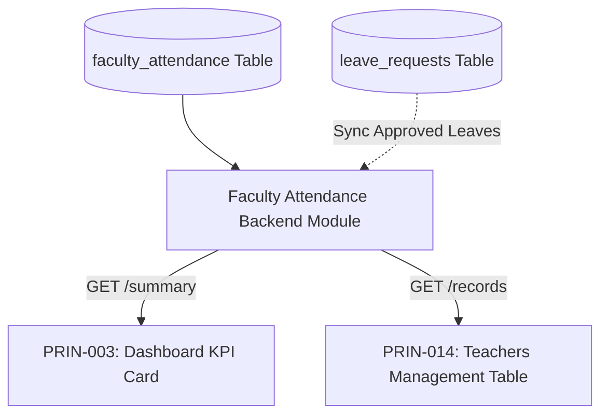

# DIGISKWELA — PHASE 5D PRINCIPAL COMPLETION 7
## PRIN-003 & PRIN-014: Faculty / Teacher Attendance Domain Discovery Audit & Design Report

**Date:** 2026-10-14  
**Project:** DigiSkwela  
**Institution:** Calulut Integrated School  
**Authoritative Progress:** 26 / 29 = 89.66% (Frozen — Audit & Architecture Phase Only)  
**Remaining Features:** PRIN-003 (Teacher Attendance List), PRIN-004 (Welfare Alerts), PRIN-014 (Faculty Attendance Table)  

---

### Executive Summary

A comprehensive repository audit was conducted across the Prisma schema (`backend/prisma/schema.prisma`), database migrations, backend routes, services, permissions/RBAC definitions, and frontend portals (Principal, Teacher, Admin).

The audit confirms **Domain Classification C: NO FACULTY ATTENDANCE DOMAIN EXISTS; NEW DOMAIN DESIGN REQUIRED**.

DigiSkwela currently maintains zero database models, tables, routes, or services for tracking daily faculty or teacher attendance. The existing attendance models (`GateAttendance` and `ClassAttendance`) are strictly dedicated to students. Both `PDashboard.tsx` (PRIN-003) and `PTeachers.tsx` (PRIN-014) currently display explicit fallback notices stating that the attendance tracking module is unavailable.

No production or schema modifications have been performed in this phase. This report establishes the factual baseline and outlines a production-grade data model, API contract, RBAC specification, and UI mapping for subsequent implementation upon user decision.

---

### 1. Repository Evidence

| Area Audited | Files / Modules Inspected | Factual Findings |
|---|---|---|
| **Prisma Schema** | `backend/prisma/schema.prisma` (747 lines, 40 models) | **0 models** exist for Teacher, Faculty, or Staff attendance. Only 2 attendance models exist: `GateAttendance` (students only) and `ClassAttendance` (students in sections). |
| **Migrations** | `backend/prisma/migrations/*` | No table or column exists for faculty attendance, clock-in, clock-out, or teacher shifts. |
| **Backend Routes** | `backend/src/attendance/attendance.routes.ts`<br>`backend/src/modules/class-attendance/*` | Endpoints strictly serve student gate scans (`/api/attendance/gate/*`) and student class attendance (`/api/attendance/class/*`). Zero routes exist for teacher attendance. |
| **Backend Services** | `backend/src/modules/class-attendance/classAttendance.service.ts` | Operates solely on student class enrollments and section rosters. |
| **Seed & RBAC** | `backend/prisma/seed.ts`<br>`backend/exec_revocations.ts` | Permissions `attendance:read`, `attendance:write`, `attendance:write_all` exist, but are mapped to student gate/class attendance. |
| **Principal UI** | `src/app/principal/dashboard/PDashboard.tsx` (line 62)<br>`src/app/principal/teachers/PTeachers.tsx` (lines 93–109)<br>`src/app/principal/attendance/PLiveFacultyAttendance.tsx` | Dashboard displays `"0 / 0"`, `"Teachers Present Today"`, `"Attendance module unavailable"`. Teachers screen displays an empty table `"Faculty Attendance Today"` with `"Faculty attendance tracking module is not currently available."`. `PLiveFacultyAttendance.tsx` is an isolated mock prototype with hardcoded interval timer/confetti (excluded from denominator under PRIN-034). |
| **Teacher UI** | `src/app/teacher/attendance/AttendanceHub.tsx`<br>`src/app/teacher/shared/useAttendance.ts` | Exclusively provides classroom attendance taking for enrolled students and SF2 export. No teacher self-attendance feature exists. |
| **Admin UI** | `src/app/admin/*` | No attendance tracking interface exists for teachers or employees. |

---

### 2. Existing Attendance-Related Domains

The repository defines two distinct attendance models, neither of which represents faculty attendance:

#### A. Gate Attendance (`GateAttendance` / `gate_attendance`)
- **Schema Definition (`backend/prisma/schema.prisma` lines 273–286):**
  ```prisma
  model GateAttendance {
    id         String    @id @db.VarChar(36)
    student_id String    @db.VarChar(36)
    date       DateTime  @db.Date
    status     String    @db.VarChar(20)
    created_at DateTime  @default(now())
    updated_at DateTime  @updatedAt
    time_in    DateTime? @db.Time(3)
    time_out   DateTime? @db.Time(3)
    student    Student   @relation(fields: [student_id], references: [id])

    @@unique([student_id, date])
    @@map("gate_attendance")
  }
  ```
- **Backend Handler (`backend/src/attendance/attendance.routes.ts`):**
  - Resolves scanned barcodes exclusively against `prisma.student.findUnique({ where: { lrn: barcode } })`.
  - Scans are recorded with `student_id`.
  - Real-time SSE updates (`/gate/events`) notify monitoring screens of student arrivals.
- **Rule:** This table CANNOT be overloaded to store faculty attendance without compromising relational foreign keys and student-specific business logic.

#### B. Class Attendance (`ClassAttendance` / `class_attendance`)
- **Schema Definition (`backend/prisma/schema.prisma` lines 288–302):**
  ```prisma
  model ClassAttendance {
    id            String                   @id @db.VarChar(36)
    date          DateTime                 @db.Date
    status        String                   @db.VarChar(5) // 'P', 'A', 'L', etc.
    remarks       String?
    created_at    DateTime                 @default(now())
    updated_at    DateTime                 @updatedAt
    assignment_id String                   @db.VarChar(36)
    enrollment_id String                   @db.VarChar(36)
    assignment    TeacherSubjectAssignment @relation(fields: [assignment_id], references: [id])
    enrollment    Enrollment               @relation(fields: [enrollment_id], references: [id])

    @@unique([assignment_id, enrollment_id, date])
    @@map("class_attendance")
  }
  ```
- **Function:** Tracks student attendance inside individual subject periods taught by a teacher. Does not record whether the teacher arrived at school.

---

### 3. Existing Teacher / Faculty Models

The repository provides the following entities representing faculty members:

#### A. `User` (`backend/prisma/schema.prisma` lines 12–46)
- **Table:** `users`
- **Relevant Fields:**
  - `id`: `String @id @db.VarChar(36)` (UUID)
  - `email`: `String @unique @db.VarChar(255)`
  - `first_name`: `String @db.VarChar(100)`
  - `last_name`: `String @db.VarChar(100)`
  - `middle_name`: `String? @db.VarChar(100)`
  - `status`: `String @default("active") @db.VarChar(20)`

#### B. `Teacher` (`backend/prisma/schema.prisma` lines 130–148)
- **Table:** `teachers`
- **Fields:**
  - `id`: `String @id @db.VarChar(36)`
  - `user_id`: `String @unique @db.VarChar(36)` (Foreign Key to `User.id`)
  - `employee_id`: `String @unique @db.VarChar(50)` (DepEd Employee ID)
  - `department`: `String? @db.VarChar(100)` (e.g., Mathematics, Science, English, MAPEH)
  - `position`: `String? @db.VarChar(100)` (e.g., Teacher I, Teacher II, Teacher III, Master Teacher I)
  - `specialization`: `String? @db.VarChar(200)`
  - `date_hired`: `DateTime?`
  - Relations: `user` (`User`), `assignments` (`TeacherSubjectAssignment[]`), `teacherRankings` (`TeacherRanking[]`), `appointments` (`Appointment[]`)

#### C. `Staff` (`backend/prisma/schema.prisma` lines 150–162)
- **Table:** `staff`
- **Fields:** `id`, `user_id`, `employee_id`, `department`, `position`.
- *Note:* While `Teacher` represents academic faculty, `Staff` represents non-teaching administrative/support personnel.

#### D. `TeacherSubjectAssignment` (`backend/prisma/schema.prisma` lines 227–252)
- **Table:** `teacher_subject_assignments`
- **Fields:** `id`, `academic_year_id`, `teacher_id`, `section_id`, `subject_id`, `days`, `start_time`, `end_time`, `room`.
- *Crucial Finding:* This entity stores class teaching schedules for individual sections (e.g. MWF 8:00–9:00 AM in Room 101), NOT overall faculty employment shift/workday hours (e.g. DepEd 8:00 AM – 5:00 PM workday).
- **There is no global faculty work shift or daily schedule table in DigiSkwela.**

---

### 4. Current UI Intent: PRIN-003 vs. PRIN-014

Inspection of the actual frontend source code clarifies the distinct operational roles of PRIN-003 and PRIN-014:

#### A. PRIN-003: Teacher Attendance List (Dashboard Summary)
- **UI File:** `src/app/principal/dashboard/PDashboard.tsx`
- **Location:** Line 62, KPI Card grid in the Principal Dashboard.
- **Current Rendering:**
  ```tsx
  {
    v: loading ? "..." : "0 / 0",
    l: "Teachers Present Today",
    sub: "Attendance module unavailable",
    subColor: C.t3,
    color: C.amber,
    bg: C.amberBg,
    icon: GraduationCap,
    dest: "p-teachers"
  }
  ```
- **Intended Purpose:**
  - Executive-level dashboard summary card and quick-access glance metric.
  - Displays real-time aggregate count: `[Present] / [Total Faculty]` (e.g., `"17 / 18"`).
  - Subtitle conveys punctuality/leave status (e.g., `"16 Present, 1 Late, 1 On Leave"`).
  - Clicking navigates directly to `p-teachers` (or opens a compact slide-over drawer).

#### B. PRIN-014: Faculty Attendance Table (Comprehensive Monitoring)
- **UI File:** `src/app/principal/teachers/PTeachers.tsx`
- **Location:** Lines 93–109 under the "Overview & Subject Load" tab.
- **Current Rendering:**
  ```tsx
  <div style={{ background:"#fff", border:`1px solid ${C.borderMed}`, overflow:"hidden" }}>
    <div style={{ background:C.m800, padding:"10px 16px", display:"flex", alignItems:"center", gap:8 }}>
      <span style={{ color:"#fff", fontSize:12, fontWeight:700, fontFamily:"'Fraunces',serif", flex:1 }}>Faculty Attendance Today</span>
      <span style={{ fontSize:10, color:"rgba(255,255,255,0.7)" }}>No Data Available</span>
    </div>
    <table style={{ width:"100%", borderCollapse:"collapse" }}>
      <thead><PTableHeader cols={["Teacher","Rank","Status","Time In"]} /></thead>
      <tbody>
        <tr>
          <td colSpan={4} style={{ padding:"24px", textAlign: "center", fontSize: 12, color: C.t3 }}>
            Faculty attendance tracking module is not currently available.
          </td>
        </tr>
      </tbody>
    </table>
  </div>
  ```
- **Intended Purpose:**
  - Full operational data table for daily faculty attendance management.
  - Displays individual faculty records with columns:
    - Teacher Name (with DepEd Employee ID)
    - Department / Specialization
    - DepEd Rank / Position (e.g., Teacher I, Master Teacher I)
    - Time In (e.g., `07:42 AM`)
    - Time Out (e.g., `05:02 PM`)
    - Status Badge (`Present`, `Late`, `On Leave`, `Absent`, `Official Business`)
    - Remarks / Source
  - Filtering capabilities: Date selector, Status filter, Department filter, Search by name.

#### C. Decorative Prototype Exclusion: PRIN-034
- `PLiveFacultyAttendance.tsx` (`src/app/principal/attendance/PLiveFacultyAttendance.tsx`) renders a mock simulation screen with hardcoded teacher arrays (`INITIAL_FACULTY`), auto-firing canvas confetti, and artificial interval timers.
- As established in earlier project milestones, this screen was an exploratory visual concept and is formally excluded from the authoritative 29 Principal requirements.

---

### 5. Leave Integration Analysis

- **Model:** `LeaveRequest` (`backend/prisma/schema.prisma` lines 432–451, table `leave_requests`)
- **Key Fields:**
  - `id`: String UUID
  - `user_id`: String (references `User.id`)
  - `type`: String (e.g., "Sick", "Vacation", "Emergency", "Maternity")
  - `start_date`: DateTime
  - `end_date`: DateTime
  - `days`: Int
  - `reason`: String
  - `status`: String (`Pending`, `Approved`, `Rejected`)
  - `approver_id`: String (references `User.id` — Principal approves)
- **Applicable Roles:** Submissions are made by Teachers and Staff.
- **Integration Boundary:**
  - An approved `LeaveRequest` whose date range includes the queried attendance date can legitimately explain a teacher's absence and classify their status as `"On Leave"`.
  - **Critical Rule:** `LeaveRequest ≠ FacultyAttendance`. Leave requests do not record daily arrival times, gate passes, or physical presence. The leave table must NOT be used as a substitute for an attendance table.

---

### 6. Existing RBAC Analysis

- **Current Attendance Permissions (`backend/prisma/seed.ts`):**
  - `attendance:read`
  - `attendance:write`
  - `attendance:write_all`
- **Role Assignments:**
  - `Principal`: `attendance:read`, `attendance:write_all`
  - `Teacher`: `attendance:read`, `attendance:write` (intended for student class attendance)
  - `GateOperator`: `attendance:write` (intended for student gate barcode scanner)
  - `Admin` / `ITAdmin`: administrative coverage
- **Finding:**
  Reusing generic `attendance:read` / `attendance:write` for faculty attendance risks privilege overlap (e.g., a GateOperator scanning students or a Teacher taking class attendance might inadvertently inherit faculty payroll attendance mutations).
- **Recommendation:** Introduce clean, isolated permissions: `faculty_attendance:read` and `faculty_attendance:write`.

---

### 7. Domain Classification

Based on repository evidence, the classification is:

### **C. NO FACULTY ATTENDANCE DOMAIN EXISTS; NEW DOMAIN DESIGN REQUIRED**

#### Detailed Justification:
1. **Zero Database Infrastructure:** No model, table, or migration exists for faculty/staff attendance.
2. **Student-Exclusive Models:** `GateAttendance` enforces a foreign key to `Student.id`. Reusing or altering it would break existing student barcode scanners, live gate events, and historical student logs.
3. **Zero Backend APIs:** There are no endpoints for querying, recording, or aggregating faculty attendance.
4. **Explicit Frontend Placeholders:** The existing Principal UI explicitly warns that the attendance module is unavailable in both the Dashboard (PRIN-003) and Teacher Management (PRIN-014).

---

### 8. Proposed Domain Design (Design Only — Not Implemented)

To provide an authoritative, production-grade foundation, the following model is proposed:

#### Proposed Prisma Model: `FacultyAttendance`

```prisma
model FacultyAttendance {
  id              String         @id @db.VarChar(36)
  teacher_id      String         @db.VarChar(36)
  date            DateTime       @db.Date
  time_in         DateTime?      @db.Time(3)
  time_out        DateTime?      @db.Time(3)
  status          String         @db.VarChar(20) // 'Present', 'Late', 'Absent', 'On Leave', 'Official Business'
  source          String         @default("manual") @db.VarChar(30) // 'scanner', 'web_self_service', 'leave_sync', 'manual'
  leave_request_id String?       @db.VarChar(36)
  remarks         String?        @db.VarChar(255)
  recorded_by_id  String?        @db.VarChar(36)
  created_at      DateTime       @default(now())
  updated_at      DateTime       @updatedAt

  teacher         Teacher        @relation(fields: [teacher_id], references: [id], onDelete: Cascade)
  leave_request   LeaveRequest?  @relation(fields: [leave_request_id], references: [id], onDelete: SetNull)
  recorded_by     User?          @relation("FacultyAttendanceRecorder", fields: [recorded_by_id], references: [id], onDelete: SetNull)

  @@unique([teacher_id, date])
  @@index([date])
  @@index([teacher_id, date])
  @@map("faculty_attendance")
}
```

#### Proposed Field Specifications:

| Field | Type | Purpose | Source | Required | Justification |
|---|---|---|---|---|---|
| `id` | `VarChar(36)` | Unique record ID | System (`generateId()`) | Yes | Standard primary key convention across DigiSkwela. |
| `teacher_id` | `VarChar(36)` | Identifies faculty member | Foreign Key -> `Teacher.id` | Yes | Unambiguously links attendance to the teacher profile. |
| `date` | `Date` | Calendar day of attendance | Record date (00:00:00Z) | Yes | Ensures exactly one attendance state per teacher per day via `@@unique([teacher_id, date])`. |
| `time_in` | `Time(3)` | Time of arrival | Clock-in event | Optional | Nullable when teacher is absent or on leave. |
| `time_out` | `Time(3)` | Time of departure | Clock-out event | Optional | Nullable during active working hours before departure. |
| `status` | `VarChar(20)` | Punctuality/presence status | Computed or assigned | Yes | Primary metric for dashboard KPIs and UI badges (`Present`, `Late`, `Absent`, `On Leave`, `Official Business`). |
| `source` | `VarChar(30)` | Origin of record | Event type | Yes | Auditability for DepEd compliance (`scanner`, `web_self_service`, `leave_sync`, `manual`). |
| `leave_request_id`| `VarChar(36)` | Reference to approved leave | Foreign Key -> `LeaveRequest.id` | Optional | Provides audit trail when status is `"On Leave"`. |
| `remarks` | `VarChar(255)` | Justification / notes | User input | Optional | Explains tardiness, official business travel, or administrative corrections. |
| `recorded_by_id` | `VarChar(36)` | Audit actor | Foreign Key -> `User.id` | Optional | Captures who made the manual entry or correction. |
| `created_at` / `updated_at` | `DateTime` | Timestamp auditing | Prisma managed | Yes | Standard audit trail. |

---

### 9. Critical Business Rules & Status Matrix

The audit surfaced several fundamental business rules that must be clarified before implementation:

| Business Rule Question | Status | Architectural / Repository Finding |
|---|---|---|
| **1. How does a faculty member record Time In?** | **REQUIRES USER DECISION** | Options include: (a) Physical barcode scanner at the gate/faculty room, (b) Web self-service button in Teacher Portal, (c) Automatic clock-in upon system login, or (d) Administrative entry. |
| **2. How is Time Out captured?** | **REQUIRES USER DECISION** | Options: Second barcode scan, web button click, or auto-fill at standard end of day. |
| **3. Is attendance manual or automated?** | **REQUIRES USER DECISION** | DigiSkwela has automated gate scanning for students, but zero automation currently wired for teachers. |
| **4. Are Teachers expected to scan at the gate?** | **REQUIRES USER DECISION** | Currently, the gate scanner resolves only student LRNs. Expanding to faculty employee IDs is a design option, not an established feature. |
| **5. Is there a dedicated staff/faculty scanner?** | **NOT VERIFIED** | No hardware route or staff scanner profile exists in the codebase. |
| **6. Is attendance based on assigned work schedule?** | **NOT VERIFIED** | `TeacherSubjectAssignment` stores section periods (e.g. 7:30–8:30 AM), not standard 8:00 AM – 5:00 PM DepEd employee work shifts. |
| **7. What constitutes Late?** | **REQUIRES USER DECISION** | A definitive threshold (e.g., Time In after 08:00 AM with 15-minute grace period) must be specified. |
| **8. What constitutes Absent?** | **REQUIRES USER DECISION** | Absence generation rule (e.g., no Time In by 12:00 PM on working days, excluding weekends and approved leaves) must be agreed upon. |
| **9. How are approved leaves represented?** | **VERIFIED** | `LeaveRequest` with `status: 'Approved'` exists and can automatically mark attendance as `"On Leave"`. |
| **10. Are weekends / non-working days excluded?** | **REQUIRES USER DECISION** | Standard DepEd calendar excludes Saturdays and Sundays unless special events are scheduled. |
| **11. Who can correct attendance records?** | **REQUIRES USER DECISION** | Typically restricted to Principal, ITAdmin, or HR Registrar. |
| **12. Who can view faculty attendance?** | **VERIFIED** | Principal (oversight over all faculty), ITAdmin (all), Teacher (views own record only). |
| **13. Does Principal have read-only or mutation rights?** | **REQUIRES USER DECISION** | Whether Principal can manually edit Time In/Out or only view records. |

---

### 10. Student Scanner Separation Rule

- The existing barcode endpoint (`POST /api/attendance/gate/scan`) was engineered specifically for student LRNs, linking directly to `Student.id`.
- Reusing the physical gate scanner for faculty is classified strictly as a **POSSIBLE DESIGN OPTION**:
  - *Option 1 (Unified Gate Scanner):* The gate scanner checks if a barcode matches a student LRN; if not found, it checks if it matches a `Teacher.employee_id`.
  - *Option 2 (Dedicated Faculty Clock-In):* A separate endpoint or web-based punch clock in the Teacher Portal.
- **Strict Rule:** Gate attendance logic will NOT be reused or expanded without explicit user authorization.

---

### 11. Proposed API Contracts (Design Only — Not Implemented)

#### A. Summary Endpoint (Supports PRIN-003)
- **Route:** `GET /api/attendance/faculty/summary`
- **Query Params:** `date=YYYY-MM-DD` (defaults to current date)
- **Auth:** Requires `faculty_attendance:read`
- **Response Shape:**
  ```json
  {
    "success": true,
    "data": {
      "date": "2026-10-14",
      "totalFaculty": 18,
      "present": 16,
      "late": 1,
      "onLeave": 1,
      "absent": 0
    }
  }
  ```

#### B. List / Table Endpoint (Supports PRIN-014)
- **Route:** `GET /api/attendance/faculty`
- **Query Params:**
  - `date`: `YYYY-MM-DD`
  - `department`: string (optional)
  - `status`: string (optional, e.g. `Present`, `Late`, `Absent`, `On Leave`)
  - `search`: string (teacher name or employee ID)
  - `page`: integer (default 1)
  - `limit`: integer (default 20)
- **Auth:** Requires `faculty_attendance:read`
- **Response Shape:**
  ```json
  {
    "success": true,
    "data": [
      {
        "id": "fa_01j...",
        "teacherId": "t_01j...",
        "employeeId": "DEPED-2024-001",
        "name": "Maria Santos",
        "department": "Science",
        "position": "Teacher III",
        "date": "2026-10-14",
        "timeIn": "07:48:12",
        "timeOut": "17:02:40",
        "status": "Present",
        "source": "web_self_service",
        "remarks": null
      }
    ],
    "pagination": {
      "page": 1,
      "limit": 20,
      "total": 18,
      "totalPages": 1
    }
  }
  ```

#### C. Mutation Endpoints (Administrative / Self-Service)
- `POST /api/attendance/faculty/record`: Manual entry or scan clock-in/out.
- `PATCH /api/attendance/faculty/:id`: Administrative status correction or note amendment.

---

### 12. Proposed RBAC Design

| Role | `faculty_attendance:read` | `faculty_attendance:write` | Permitted Scope |
|---|:---:|:---:|---|
| **Principal** | **Granted** | **Granted (or Read-Only)** | Full oversight of all faculty; can review, filter, and adjust records. |
| **ITAdmin** | **Granted** | **Granted** | Full administrative and configuration control. |
| **Admin** | **Granted** | **Granted** | General administrative management. |
| **Teacher** | Restricted to own records | Restricted to own clock-in | Views own daily attendance logs in Teacher Portal. |
| **Registrar** | **Granted** (optional) | Denied | Auditing and official DepEd Form 48 reporting. |
| **GateOperator**| Denied | Conditional | Granted only if physical gate scanning includes faculty. |

---

### 13. UI Design Mapping (PRIN-003 & PRIN-014)

Both requirements can be cleanly powered by this single authoritative backend domain:



#### A. PRIN-003 Dashboard Implementation Plan
- **Location:** `PDashboard.tsx`
- **Component:** KPI card replaces static `"0 / 0"` with live data:
  - Metric: `"${summary.present} / ${summary.totalFaculty}"`
  - Subtitle: `"${summary.late} Late · ${summary.onLeave} On Leave"`
  - Status pill: Amber / Green depending on presence percentage.
  - Interactive click navigates to `p-teachers` with today's date pre-selected.

#### B. PRIN-014 Teachers Screen Implementation Plan
- **Location:** `PTeachers.tsx` (replacing placeholder lines 93–109)
- **UI Elements:**
  - **Toolbar:** Date picker (default today), Department dropdown filter, Status dropdown filter (`All`, `Present`, `Late`, `Absent`, `On Leave`), search input.
  - **Table Columns:**
    - Teacher (Avatar/Initials, Full Name, Employee ID)
    - Department
    - Rank / Position (DepEd Rank badge)
    - Time In (Formatted time or "—")
    - Time Out (Formatted time or "—")
    - Status (Tailwind badge: Green for Present, Amber for Late, Blue for On Leave, Red for Absent)
    - Source / Actions (Information popover or manual override modal)
  - **States:** Loading skeleton, interactive table, empty state ("No attendance records found"), error state with retry.

---

### 14. Styling & Tailwind Convention

All future UI implementations will follow DigiSkwela's established design language:
- Clean Tailwind CSS utility classes for layout, flexbox, grid, and spacing.
- Design tokens from `src/app/shared/constants/tokens.ts` for institutional colors (Maroon `C.m800`, Gold `C.gold`, Slate borders, status pill accents).
- High-readability typography (`Fraunces` serif headings, `Plus Jakarta Sans` body, `JetBrains Mono` for employee IDs and timestamps).

---

### 15. Risks & Considerations

1. **Schema Migration Impact:** Adding `faculty_attendance` requires a Prisma migration. Careful execution is necessary to preserve existing PostgreSQL tables and constraints.
2. **Attendance Source Ambiguity:** If the school has no barcode scanner dedicated to faculty, an unverified assumption about hardware scanning would fail in practice. Self-service web check-in or daily automated baseline generation is safer.
3. **Absence Generation:** In a real school, teachers who do not clock in are not recorded by scanners; their "Absent" records must be generated by a daily scheduled job or dynamically inferred by comparing registered teachers against attendance logs.

---

### 16. Recommended Next Steps

1. **User Decision Review:** Review Section 9 decisions (clock-in method, late threshold, automated absence rule).
2. **Schema & Migration Phase:** Once decisions are approved, create the `FacultyAttendance` model in `schema.prisma` and run migration.
3. **Backend Implementation:** Build `facultyAttendance.routes.ts`, controller, and service with full RBAC and audit logging.
4. **Seed Test Data:** Seed realistic faculty attendance for canonical demo teachers for testing.
5. **Frontend Implementation:**
   - Update `PDashboard.tsx` (PRIN-003).
   - Update `PTeachers.tsx` (PRIN-014).
6. **Manual Verification:** Verify in browser with canonical demo account (`principal@calulut.edu.ph`).

---

**Report Status:** COMPLETE — AWAITING USER DIRECTION  
**Current Progress:** 26 / 29 = 89.66% (Unchanged)
